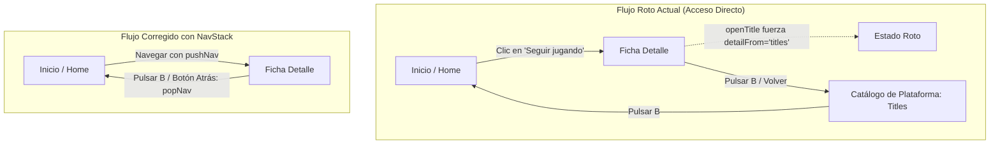

# Informe Técnico: Unificación y Corrección del Flujo de Navegación (Mando y Ratón)

> **Versión de la app:** 1.7.4  
> **Fecha:** Noviembre 2026  
> **Área:** Experiencia de Usuario, Controlador (`src/lib/controller.svelte.ts`), Navegación, Componentes de Pantalla y Soporte TV/Mando/Ratón.

---

## 1. Resumen Ejecutivo

Tras auditar exhaustivamente el árbol de pantallas (`src/screens/*`), los componentes visuales (`src/components/*`) y los módulos de lógica de entrada (`controller.svelte.ts`, `milista.svelte.ts`, `coleccion.svelte.ts`, `store.svelte.ts`), se concluye que **el sistema de navegación adolece de tres fallos arquitectónicos estructurales**:

1. **Falta de una pila de navegación unificada (History Stack):** La app gestiona los saltos entre pantallas mediante estados escalares aislados (`detailFrom`, `viewerFrom`, `gsFrom`, `streakFrom`). Al entrar a un juego desde un **acceso directo** (como *«Seguir jugando»* en Inicio), la función `openTitle` sobreescribe el origen a `'titles'` y resetea las pestañas. Al pulsar **B** (o botón atrás), en lugar de devolver al menú de Inicio, el usuario queda **atrapado en mitad del catálogo de la plataforma** (`titles`).
2. **Inconsistencias críticas con el Ratón:** Numerosos selectores esenciales (las pestañas de *Mi lista / Colecciones / Catálogo*, los filtros de saga, las categorías de estadísticas, los tipos de métricas y los puntos del resumen anual) son elementos visuales `<span>` pasivos **sin manejadores `onclick`**. Además, las migas de pan (`TopBar`) no son clicables, no existe un botón visible de volver atrás, y la rueda del ratón en *Mi lista* y *Colecciones* cambia de franja verticalmente en vez de desplazar horizontalmente las portadas que quedan fuera de pantalla.
3. **Incoherencias de Mando y Zonas Inaccesibles (Focus Traps):** 
   - Existe una **contradicción flagrante entre los botones indicados en los *Hints* y la acción real del mando**: en la lista de juegos, el hint inferior dice `LB/RB Pestaña`, pero al pulsar `LB/RB` el controlador cambia de página de juegos (+10) o salta portadas (+4); el cambio real de pestaña se realiza con `LT/RT` o `View`.
   - Si una plataforma no tiene juegos con estado, la pantalla de *Mi lista* no genera ningún elemento enfocable (`.fx`), dejando el foco vacío; el texto pide usar `Y`, pero la tecla `Y` está bloqueada si no hay juego enfocado, atrapando al usuario.
   - En la ficha de detalle (`Detail.svelte`), las píldoras de estado (`dst`) y fecha (`drel`) no están registradas en `validKey`, invalidando el foco.

---

## 2. Diagnóstico Detallado de Problemas



### 2.1. Problema 1: Rutas Rotas al entrar por Accesos Directos

#### El caso de «Seguir jugando» (`openRecent`)
En `src/lib/controller.svelte.ts` (líneas 657-662):
```ts
function openRecent(i: number) {
  const r = app.recent[i];
  if (!r) return;
  app.p = r.pi; app.hp = r.pi; app.titleFilter = 'all'; app.titlesTab = 'all'; resetList(); resetColl();
  openTitle(r.ti);
}
```
Y en `openTitle(i: number)` (líneas 393-405):
```ts
export function openTitle(i: number) {
  ...
  app.detailFrom = 'titles'; // <-- HARDCODEADO SIEMPRE A 'titles'
  ...
  go('detail', 'fwd');
}
```
Y en el retorno con **B** (`back()`, líneas 891-895):
```ts
} else if (app.view === 'detail') {
  if (app.detailFrom === 'stats') { go('stats', 'back'); blip(520); return; }
  if (app.detailFrom === 'gstats') { go('gstats', 'back'); blip(520); return; }
  if (app.titlesTab !== 'coll') app.fk.titles = 'tit' + app.t;
  go('titles', 'back'); // <-- Vuelve a 'titles' porque detailFrom no contempla 'home'
}
```
**Consecuencia inmediata:**
1. El usuario está en el menú de Inicio (`home`).
2. Hace clic en un juego reciente en *«Seguir jugando»*.
3. Entra a la ficha del juego (`detail`).
4. Pulsa **B** o hace clic derecho / atrás para regresar al menú.
5. **En vez de volver a Inicio, aparece en la pestaña Catálogo de la plataforma**, perdiendo su posición anterior, su pestaña activa (`titlesTab` forzada a `'all'`) y su contexto de navegación.

#### Fragmentación de variables de retorno
Actualmente existen múltiples variables aisladas que intentan recordar el origen, sin sincronización entre sí:
- `app.detailFrom: 'titles' | 'stats' | 'gstats'` (ni siquiera admite `'home'` en su tipado de `store.svelte.ts` L407).
- `app.viewerFrom: 'detail' | 'shots'`
- `app.gsFrom: 'evo' | 'titles'`
- `app.streakFrom: 'home' | View`
- `app.overlayStack: Overlay[]` (que se destruye por completo si cualquier función invoca `closeOverlay()`).

Si el usuario realiza una navegación profunda desde un acceso directo:
$$\text{Inicio} \xrightarrow{\text{rec}} \text{Detalle} \xrightarrow{\text{dall}} \text{Capturas} \xrightarrow{\text{shot}} \text{Visor}$$
Al pulsar atrás consecutivamente:
$$\text{Visor} \to \text{Capturas} \to \text{Detalle} \to \mathbf{Catálogo\ de\ Plataforma\ (Titles)}$$
Se rompe la expectativa mental del usuario: **un acceso directo debe devolverte a la pantalla desde la que lo invocaste.**

---

### 2.2. Problema 2: Inconsistencias con el Ratón

| Pantalla / Componente | Elemento | Estado Actual | Problema para Ratón |
|---|---|---|---|
| `Titles.svelte` (L189-191) | Pestañas *Mi lista / Colecciones / Catálogo* | `<span class="tflt">` | **No clicable**. Si el usuario hace clic sobre el nombre de la pestaña, no ocurre nada. |
| `Titles.svelte` (L193) | Selector de orden A-Z / Color | `<span class="tflt tord">` | Solo el diminuto botón `X` (`.btn.x`) es clicable; el texto del orden es estático. |
| `TopBar.svelte` (L28-32) | Migas de pan (*Crumbs*) | `<div class="crumb pill"><span>` | **No clicable**. El usuario no puede pulsar «Inicio» para retroceder en la jerarquía. |
| Toda la App | Botón «Atrás» universal | Ausente | No existe botón de retroceso visible en cabecera. Solo responde al clic derecho o botón auxiliar 4. |
| `Shots.svelte` (L110-113) | Filtro de saga / juego | `<span class="sf">` | **No clicable**. En una colección con varios juegos, no se puede filtrar con el ratón. |
| `Stats.svelte` (L69) | Selector de plataforma | `<span class="cat">` | **No clicable**. No se puede cambiar de categoría con ratón (requiere LT/RT en mando). |
| `GameStats.svelte` (L38) | Selector de métricas | `<span class="t">` | **No clicable**. Requiere botones LB/RB en mando. |
| `Evo.svelte` (L71) | Selector de escala (días/sem/año) | `<span class="t">` | **No clicable**. Solo responden los iconos LB/RB. |
| `Year.svelte` (L228) | Indicadores de tarjeta anual | `<i>` pasivos | **No clicable**. No se puede saltar directamente a una tarjeta con el ratón. |
| `MiListaDual.svelte` (L178) | Franjas horizontales de juegos | `overflow: hidden` | **Scroll bloqueado**. `onWheel` (L1918) intercepta la rueda para mover verticalmente de franja en vez de deslizar horizontalmente los juegos. |
| `App.svelte` (L156 vs L168) | Contenedor `#screen` vs Overlays | Eventos solo en `#screen` | Los modales (`Settings`, `AchievementsModal`, `Saves`, etc.) quedan fuera de `#screen`. `onmousemove` no los cubre y la detección de hover de foco no opera uniformemente. |

---

### 2.3. Problema 3: Inconsistencias con Mando y Zonas Inaccesibles

#### 1. Contradicción entre Hints y Controlador en `Titles.svelte`
- En la barra inferior (`Hints.svelte`):
  - Línea 321: `['LB/RB', 'Pestaña', 'rb']`
  - Línea 329: `['LB/RB', 'Pestaña', 'rb']`
  - Línea 340: `['LB/RB', 'Pestaña', 'rb']`
- En el código del controlador (`controller.svelte.ts` L923):
  - `page(d)` (asignado a **LB/RB**):
    ```ts
    if (app.view === 'titles') {
      const n = app.tview.length;
      if (!n || !onAllTab()) return; // En 'list' o 'coll' NO HACE NADA
      // En 'all', salta 10 portadas (cambia de PÁGINA, no de pestaña)
      ...
    }
    ```
  - En `milista.svelte.ts` (L372):
    - `case 'lb': listShift(-1);` (salta 4 portadas dentro de la franja, **no cambia pestaña**).
  - En `coleccion.svelte.ts` (L188):
    - `case 'lb': collShift(-1);` (salta portadas en la balda, **no cambia pestaña**).
  - ¿Cómo se cambia realmente de pestaña? Con **LT / RT** (`shift(d)` L960) o el botón **View** (`cmd('view')` L1753).
- **Resultado:** El usuario lee en pantalla que debe pulsar `LB/RB` para cambiar de pestaña, pero al pulsarlo salta juegos o no hace nada. Y si hace clic sobre el hint con el ratón, se envía `'rb'`, por lo que tampoco cambia de pestaña.

#### 2. Claves de Foco Inválidas en `validKey` (`Detail.svelte`)
En `src/lib/controller.svelte.ts` (líneas 107-115):
```ts
} else if (view === 'detail') {
  const t = app.platform?.titles[app.t];
  if (!t) return undefined;
  if (key === 'play') return t.launchable ? key : undefined;
  if (key === 'dach') return key;
  if (/^ds\d+$/.test(key)) return n < Math.min(DETAIL_SHOTS, t.shots.length) ? key : undefined;
  if (key === 'dall') return t.shots.length ? key : undefined;
  if (key === 'dhrs' || (key === 'dwk' && t.launchable)) return t.plays?.length ? key : undefined;
}
```
En la plantilla de `Detail.svelte`:
- Línea 160: `class="stpill fx" data-k="dst" data-act="status"` (Píldora de estado)
- Línea 183: `class="relpill fx" data-k="drel" data-act="release"` (Píldora de fecha de lanzamiento)
Ni `'dst'` ni `'drel'` están permitidas en `validKey`. Si el foco cae sobre ellas y se produce un refresco o cambio de vista, `validKey` devuelve `undefined` y el foco se reinicia involuntariamente.

#### 3. Trampa de Foco en `MiListaDual.svelte` Vacía
Si la plataforma activa no tiene ningún juego con estado (*Jugando, Pendiente, Terminado, Abandonado*):
1. `buildBoard()` (L188) devuelve `[]`.
2. `listFirst()` (L204) devuelve `undefined`.
3. `defaultKey('titles')` (L131) asigna foco vacío `''`.
4. En el DOM no se renderiza ningún elemento con clase `.fx`.
5. La pantalla muestra: `«Aún no hay juegos en tu lista. Marca el estado de un juego con Y.»`
6. El usuario pulsa **Y**: `listCmd` comprueba `if (listHas(app.t))` que es `false`, hace un *bump* sonoro y **no abre nada**.
7. El usuario pulsa **LB/RB**: bloqueado.
8. El usuario pulsa **cruceta/sticks**: bloqueado.
El usuario queda **atrapado en un callejón sin salida** sin poder marcar ningún juego ni cambiar de pestaña mediante los controles indicados.

#### 4. Buscador de Juegos (`tsearch`) Inaccesible con Mando
- El campo `<input placeholder="Buscar juego...">` en `Titles.svelte` no posee clase `.fx` ni identificador de foco `data-k`.
- No es posible alcanzarlo mediante navegación espacial con el stick o cruceta.
- El hint indica `['Y', 'Buscar / Vista', 'y']`, pero al pulsar `Y` en el catálogo se ejecuta `toggleTitlesView()` (alternar cuadrícula y carrusel), sin abrir el buscador ni desplegar el teclado en pantalla (`Osk`).
- Si un usuario hace clic en el input y escribe con teclado físico, `onKeyDown` bloquea los comandos con `tag === 'INPUT'`, impidiendo salir del input con la tecla Escape.

#### 5. Navegación Espacial Desfasada por Transforms CSS
La función `pos(e, root)` en `controller.svelte.ts` (L187-196) calcula la posición acumulando `n.offsetLeft` y `n.offsetTop`. 
Sin embargo, contenedores como `.ttrack` (en cuadrícula de títulos) y `.ctrack` (en carrusel) utilizan traslaciones CSS dinámicas:
- `transform: translateY({-pg * PH}px)`
- `transform: translateX({640 - 100 - q * 240}px)`
`offsetLeft` y `offsetTop` **ignoran por completo los transforms CSS**. Esto provoca que las distancias geométricas calculadas entre portadas de páginas virtuales adyacentes no coincidan con su posición real en la pantalla de 1280×720, causando saltos erráticos o bloqueos al navegar entre filas inferior y superior de distintas páginas.

---

## 3. Plan de Arquitectura y Solución Técnica

### 3.1. Fase 1: Pila de Navegación Unificada (`NavStack`)

Reemplazar las variables ad-hoc por un sistema centralizado de historial en `store.svelte.ts` y `controller.svelte.ts`.

#### Estructura de Datos
```ts
export interface NavEntry {
  view: View;
  p: number;
  t: number;
  s: number;
  focus: string;
  titlesTab?: TitlesTab;
  statsTab?: 'rank' | 'cal' | 'year';
  gsScope?: 'title' | 'cat';
  favView?: boolean;
  collOpen?: string | null;
  detailFrom?: string; // Para compatibilidad
}
```

#### Métodos del Controlador
1. `pushNav(v: View, params?: Partial<NavEntry>)`:
   - Guarda una captura completa del estado actual (`view`, `p`, `t`, `s`, `focus`, `titlesTab`, etc.) en la pila `app.navHistory`.
   - Aplica los nuevos parámetros y transiciona con `go(v, 'fwd')`.
2. `popNav()`:
   - Si `app.navHistory.length > 0`, extrae la última entrada (`prev = app.navHistory.pop()`).
   - Restaura exactamente: `app.p = prev.p`, `app.t = prev.t`, `app.s = prev.s`, `app.titlesTab = prev.titlesTab`, `app.favView = prev.favView`, etc.
   - Navega a `prev.view` con animación `'back'` y restaura el foco a `prev.focus`.
   - Si la pila está vacía y no estamos en `home`, retrocede a `home`.

#### Corrección directa de Accesos Directos
- En `openRecent(i)`:
  ```ts
  function openRecent(i: number) {
    const r = app.recent[i];
    if (!r) return;
    pushNav('detail', { p: r.pi, hp: r.pi, t: r.ti, s: 0 });
  }
  ```
- Al pulsar **B** en `detail`, `popNav()` restaura la pantalla de `home` con el foco en la tarjeta `rec${i}` exacta de la que partió.

---

### 3.2. Fase 2: Soporte e Interactividad Completa para Ratón

#### 1. Cabecera Universal (`TopBar.svelte`)
- **Migas de pan clicables:**
  Transformar los segmentos de `crumbs` en botones semánticos:
  - Clic en `Inicio` $\to$ navega directo a `home`.
  - Clic en el nombre de la plataforma $\to$ navega a `titles` de esa plataforma.
- **Botón Atrás:**
  Incorporar en el extremo izquierdo de la píldora de migas un icono chevron interactivo `‹` visible cuando `app.view !== 'home'` o `app.overlay !== ''`:
  ```svelte
  {#if canGoBack}
    <button type="button" class="back-btn" onclick={cmdBack} title="Volver (B / Clic derecho)">
      {@html ICON.chevL}
    </button>
  {/if}
  ```

#### 2. Convertir Selectores Pasivos en Clicables
- **En `Titles.svelte`:**
  - Convertir `<span class="tflt" class:on={tab === f}>{label}</span>` en `<button type="button" class="tflt" onclick={() => setTab(f)}>`.
  - Permitir clic en el selector de orden `TITLE_ORDER_LABEL`.
- **En `Shots.svelte`:**
  - Agregar `onclick={() => setSagaFilter(k)}` en cada `<span class="sf">`.
- **En `Stats.svelte`, `GameStats.svelte` y `Evo.svelte`:**
  - Añadir manejadores `onclick` en todas las píldoras de pestañas y métricas.
- **En `Year.svelte`:**
  - Permitir hacer clic directo en los puntos `<i>` para saltar a cualquier tarjeta anual.

#### 3. Soporte de Rueda Horizontal en *Mi Lista* y *Colecciones*
- En `onWheel` (`controller.svelte.ts`):
  - Detectar el contenedor bajo el cursor (`e.target.closest('.its, .rtrack')`).
  - Si el cursor está sobre una franja horizontal, la rueda del ratón (`deltaY` o `deltaX`) debe realizar `scrollBy({ left: delta * factor, behavior: 'smooth' })`, permitiendo ver y pulsar títulos más allá del borde de la pantalla.

---

### 3.3. Fase 3: Corrección de Foco de Mando y Zonas Inaccesibles

#### 1. Armonización de *Hints* vs Asignación de Teclas
- **Regla estándar de ergonomía para mando (según `ANTIGRAVITY.md`):**
  - **LB / RB:** Cambio de pestaña principal (*Mi lista $\leftrightarrow$ Colecciones $\leftrightarrow$ Catálogo* en `Titles`, Anillos en `Streak`, Pestañas en `Stats`).
  - **LT / RT:** Paginación de contenido largo o salto rápido (subir/bajar página en cuadrícula, años en resumen anual).
- **Ajustes:**
  - En `Titles.svelte`, asegurar que `page(d)` (LB/RB) ejecute `cycleTitlesTab(d)` en todas las pestañas.
  - Actualizar los textos de los *Hints* para que coincidan al 100% con la acción ejecutada.

#### 2. Corrección de `validKey` y `defaultKey`
- En `controller.svelte.ts`:
  ```ts
  } else if (view === 'detail') {
    const t = app.platform?.titles[app.t];
    if (!t) return undefined;
    if (key === 'play') return t.launchable ? key : undefined;
    if (key === 'dach' || key === 'dst' || key === 'drel') return key; // <-- AÑADIDOS
    if (/^ds\d+$/.test(key)) return n < Math.min(DETAIL_SHOTS, t.shots.length) ? key : undefined;
    if (key === 'dall') return t.shots.length ? key : undefined;
    if (key === 'dhrs' || (key === 'dwk' && t.launchable)) return t.plays?.length ? key : undefined;
  }
  ```
  Y en `defaultKey('detail')`: Si un juego no tiene capturas ni lanzador, priorizar `'dst'` o `'dach'`, nunca devolver cadena vacía `''`.

#### 3. Resolución de Estado Vacío en *Mi Lista*
- Cuando `bands.length === 0`, renderizar en `MiListaDual.svelte` una tarjeta o botón activo con clase `.fx` (`data-k="list-empty"`):
  ```svelte
  {#if !bands.length}
    <div class="empty-action fx f" data-k="list-empty" data-act="list-add">
      <p>Aún no hay juegos en tu lista.</p>
      <span class="btn a">A</span> Ir al Catálogo para añadir juegos
    </div>
  {/if}
  ```
  Esto garantiza que el foco nunca se pierda y el usuario siempre tenga una salida clara con el mando.

#### 4. Navegación Espacial Geométrica Robusta
- Modificar `pos(e, root)` para utilizar `e.getBoundingClientRect()` en relación a `root.getBoundingClientRect()` y la escala uniforme del escenario (`sc`), asegurando que las coordenadas tomen en cuenta todas las traslaciones y animaciones de CSS de forma fidedigna.

---

## 4. Matriz de Archivos Afectados y Plan de Implementación

| Archivo | Problema Abordado | Líneas Aprox. | Solución Técnica | Prioridad |
|---|---|---|---|---|
| `src/lib/store.svelte.ts` | Pila de historial y tipado | L310-315, L406-407 | Agregar `navHistory: NavEntry[]`, ampliar `detailFrom` a `'home' \| 'titles' \| 'stats' \| 'gstats'`. | **Alta** |
| `src/lib/controller.svelte.ts` | Rutas rotas, `validKey`, hints LB/RB, `pos()` | L88-145, L325-343, L657-662, L862-915, L918-965, L1810-1940 | Implementar `pushNav` y `popNav`, registrar `'dst'/'drel'` en `validKey`, alinear LB/RB a pestañas, cálculo de posiciones con `getBoundingClientRect`. | **Alta** |
| `src/components/TopBar.svelte` | Navegación con ratón y botón volver | L26-53 | Migas de pan clicables con `pushNav`/`popNav`, botón visual de retroceso para ratón. | **Alta** |
| `src/screens/Titles.svelte` | Pestañas no clicables, contradicción hints, búsqueda | L187-215, L316-345 | Pestañas clicables con ratón, hint corregido, soporte de foco/OSK para buscador. | **Alta** |
| `src/screens/MiListaDual.svelte` | Trampa de foco vacía, scroll con rueda | L33-97, L178-180 | Elemento `.fx` en estado vacío para evitar trampa de foco; scroll horizontal con ratón. | **Media** |
| `src/screens/Detail.svelte` | Foco en píldoras de estado/fecha | L160-185 | Navegación bidireccional estable entre hero, píldoras y panel inferior. | **Media** |
| `src/screens/Shots.svelte` | Filtro de saga no clicable | L110-114 | Píldoras `.sf` clicables con ratón para filtrar capturas por juego de la colección. | **Media** |
| `src/screens/Stats.svelte` | Selector de plataforma no clicable | L67-97 | Selector de categoría y tipos de periodo clicables con ratón. | **Baja** |
| `src/screens/GameStats.svelte` | Métricas no clicables | L36-41 | Píldoras `.stabs` clicables con ratón. | **Baja** |
| `src/screens/Year.svelte` | Puntos anuales no clicables | L226-230 | Dots anuales interactivos con ratón. | **Baja** |

---

## 5. Próximos Pasos Recomendados

1. **Revisión del usuario:** Validar si se desea comenzar la implementación aplicando el **Fase 1 (Pila de Navegación Unificada y corrección del acceso directo de Seguir jugando)** y **Fase 2 (Interactividad de TopBar y pestañas con ratón)**.
2. **Compatibilidad:** Todos los cambios propuestos respetan estrictamente la regla de oro del proyecto (*«Las categorías no se tocan»*, diseño base a 1280×720 y estética Wii U de cristal translúcido con arcoíris).
